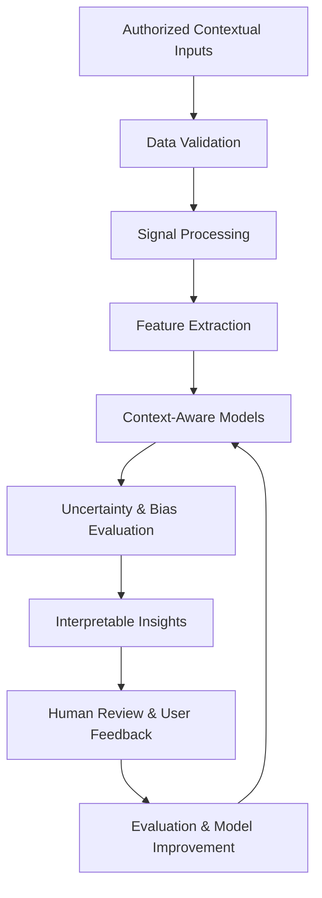

# Resonance

### See what the room feels.

**Resonance is an emotional atmosphere intelligence platform exploring how technology can help people understand, interpret, and navigate the emotional dynamics of shared environments.**

By bringing together contextual signals, environmental awareness, interaction patterns, machine learning research, and human-centered insights, Resonance envisions a new interface between human experience and intelligent systems.

The goal is not to read minds or reduce people to scores. It is to help individuals, teams, educators, and organizations recognize patterns in their environments, understand potential sources of tension or harmony, and make more thoughtful decisions.

  <a href="https://926d9807-657a-472e-a9df-5462dc63059b-v3-figmaiframepreview.figma.site/">
    <strong>Explore the Resonance Prototype →</strong>
  </a>

---

## Contents

- [Vision](#-vision)
- [Core Capabilities](#-core-capabilities)
- [Platform Modules](#-platform-modules)
- [The Sixth Sense System](#-the-sixth-sense-system)
- [How It Works](#-how-it-works)
- [Applications](#-applications)
- [Ethics and Privacy](#-ethics-and-privacy)
- [Machine Learning Research](#-machine-learning-research)
- [Development Roadmap](#-development-roadmap)
- [Research Principles](#-research-principles)
- [Project Status](#-project-status)
- [Contributing](#-contributing)
- [License](#-license)

---

## 🌐 Vision

Human environments contain signals that conventional software rarely attempts to interpret collectively.

A classroom can become disengaged before anyone raises a concern. A team can accumulate tension during a difficult meeting. A social environment can become uncomfortable without any single observable event explaining why.

Resonance explores whether responsible, context-aware technology can help people recognize these patterns earlier and respond constructively.

Our long-term vision is to build an **environmental intelligence interface for human-centered decision-making**.

Resonance aims to connect:

- **Perception:** Understand observable contextual signals in shared environments.
- **Interpretation:** Investigate patterns associated with engagement, stress, comfort, and group interaction.
- **Forecasting:** Explore uncertainty-aware predictions of changing environmental conditions.
- **Guidance:** Offer supportive recommendations that preserve human judgment.
- **Learning:** Evaluate models against real-world evidence, limitations, and feedback.
- **Trust:** Make privacy, consent, transparency, and human agency foundational to the system.

> The ambition is not to automate empathy. It is to develop tools that help people practice it more consciously.

## 🎯 Core Capabilities

Resonance organizes its capabilities around a collection of interconnected intelligence modules.

| Capability | Purpose |
|---|---|
| Emotional Atmosphere Index | Explore a composite representation of an environment's perceived emotional climate. |
| Conversation Harmony Score | Investigate patterns of conversational participation, coordination, and interaction quality. |
| Stress Level Indicator | Explore contextual indicators of tension and environmental strain. |
| Atmosphere Mapping | Visualize contextual patterns across spaces, sessions, or environments. |
| Emotional Weather Forecast | Investigate how observed patterns and contextual events may relate to future conditions. |
| Personal Insights | Help users reflect on their own patterns and experiences over time. |
| ML Model Laboratory | Support model experimentation, evaluation, visualization, and optimization. |
| Team Dynamics | Explore group-level interaction patterns without reducing individuals to fixed labels. |
| Haptic Control | Investigate discreet, consent-based ways to communicate useful contextual information. |

**Measurement disclaimer:** The numerical indicators in the current prototype are illustrative interface values. They should not be interpreted as validated psychological measurements, clinical assessments, or verified real-time sensor outputs.

---

## 🧭 Platform Modules

### 1. Overview

The central dashboard for understanding the current state of the Resonance environment.

**Explore:** [Overview](https://926d9807-657a-472e-a9df-5462dc63059b-v3-figmaiframepreview.figma.site/)

Designed to bring key indicators, environmental summaries, and emerging observations into a single interface.

### 2. Atmosphere Map

Explore the spatial and contextual dimensions of an environment.

**Explore:** [Atmosphere Map](https://926d9807-657a-472e-a9df-5462dc63059b-v3-figmaiframepreview.figma.site/atmosphere-map)

Potential capabilities include:
- Spatial visualization of environmental patterns.
- Comparison between spaces, sessions, and time periods.
- Contextual overlays and observations.
- Exploration of relationships between environmental conditions and interaction patterns.

### 3. Analytics

Turn observations into interpretable trends.

**Explore:** [Analytics](https://926d9807-657a-472e-a9df-5462dc63059b-v3-figmaiframepreview.figma.site/analytics)

Potential capabilities include:
- Historical trend analysis.
- Aggregated environmental indicators.
- Comparison across contexts.
- Confidence and uncertainty visualization.
- Evidence-oriented reporting.

### 4. Haptic Control

Explore how contextual information could be delivered through discreet tactile feedback.

**Explore:** [Haptic Control](https://926d9807-657a-472e-a9df-5462dc63059b-v3-figmaiframepreview.figma.site/haptic-control)

Research directions include configurable feedback patterns, accessibility-oriented interaction, user-controlled notifications, and optional interventions that do not interrupt social situations.

### 5. Classroom

Investigate how classroom conditions relate to participation, comfort, and learning experiences.

**Explore:** [Classroom](https://926d9807-657a-472e-a9df-5462dc63059b-v3-figmaiframepreview.figma.site/classroom)

Possible applications include educator-led environmental reflection, anonymous group feedback, and research into classroom participation.

Resonance should support educators and learners rather than classify individual students or infer their private mental states.

### 6. Workplace

Explore environmental conditions that may influence collaboration and team effectiveness.

**Explore:** [Workplace](https://926d9807-657a-472e-a9df-5462dc63059b-v3-figmaiframepreview.figma.site/workplace)

Potential applications include meeting reflection, team climate surveys, collaboration analysis, and identifying organizational conditions worth investigating.

### 7. Social Navigation

Explore ways to help users navigate social situations with greater awareness.

**Explore:** [Social Navigation](https://926d9807-657a-472e-a9df-5462dc63059b-v3-figmaiframepreview.figma.site/social-navigation)

The research direction emphasizes user-controlled assistance, contextual awareness, accessibility, and reflective guidance rather than prescriptive judgments about other people.

### 8. Ethics & Privacy

Make responsible data practices part of the product architecture.

**Explore:** [Ethics & Privacy](https://926d9807-657a-472e-a9df-5462dc63059b-v3-figmaiframepreview.figma.site/ethics)

This module defines the principles that should govern data collection, consent, retention, processing, access, and the appropriate use of inferred information.

### 9. Future Vision

Explore the long-term possibilities of atmosphere intelligence.

**Explore:** [Future Vision](https://926d9807-657a-472e-a9df-5462dc63059b-v3-figmaiframepreview.figma.site/vision)

Potential directions include multimodal contextual intelligence, ambient computing, human-machine collaboration, adaptive interfaces, and privacy-preserving environmental models.

### 10. Sixth Sense

Investigate the foundational components required for responsible atmosphere sensing.

**Explore:** [Sixth Sense System](https://926d9807-657a-472e-a9df-5462dc63059b-v3-figmaiframepreview.figma.site/sixth-sense)

The concept explores how multiple contextual inputs could contribute to an interpretable representation of environmental conditions.

### 11. Emotional Weather Forecast

Explore how environmental patterns may change over time.

**Explore:** [Forecast](https://926d9807-657a-472e-a9df-5462dc63059b-v3-figmaiframepreview.figma.site/forecast)

Research directions include:
- Temporal pattern analysis.
- Contextual event integration.
- Uncertainty-aware forecasting.
- Five-day forecast interfaces.
- Comparison of predicted conditions against observed outcomes.

Forecasts should remain probabilistic, explainable, and explicitly limited by the available evidence.

### 12. Personal Insights

Support private reflection and personal awareness.

**Explore:** [Personal Insights](https://926d9807-657a-472e-a9df-5462dc63059b-v3-figmaiframepreview.figma.site/insights)

Potential features include user-defined reflections, personal trend exploration, configurable recommendations, and transparent control over personal data.

### 13. ML Laboratory

Explore the research systems behind atmosphere intelligence.

**Explore:** [ML Lab](https://926d9807-657a-472e-a9df-5462dc63059b-v3-figmaiframepreview.figma.site/ml-lab)

Potential capabilities include:
- Dataset exploration and validation.
- Baseline model development.
- Feature engineering and ablation studies.
- Model comparison and evaluation.
- Calibration and uncertainty analysis.
- Experiment tracking and reproducibility.

### 14. Team Dynamics

Investigate how collective interaction patterns change over time.

**Explore:** [Team Dynamics](https://926d9807-657a-472e-a9df-5462dc63059b-v3-figmaiframepreview.figma.site/team-dynamics)

The research direction focuses on aggregate patterns such as conversational balance, coordination, participation, and reported team experience—not individual surveillance or automated employee judgments.

---

## 🧠 The Sixth Sense System

The Sixth Sense concept is the proposed intelligence foundation connecting contextual inputs with interpretable insights.

A responsible implementation could explore the following ten components:

1. **Context Acquisition** — Collect explicitly authorized environmental or interaction data.
2. **Signal Processing** — Validate, normalize, and transform permitted inputs.
3. **Context Representation** — Represent the relevant situation, space, and time.
4. **Feature Engineering** — Extract meaningful, testable characteristics.
5. **Pattern Recognition** — Identify patterns supported by empirical evidence.
6. **Multimodal Fusion** — Investigate how complementary signals can be combined.
7. **Uncertainty Estimation** — Represent ambiguity, missing data, and model limitations.
8. **Temporal Forecasting** — Investigate how patterns change over time.
9. **Human Interpretation** — Present findings with explanations and alternative interpretations.
10. **Feedback and Evaluation** — Compare outputs against appropriate reference data and user feedback.

These components describe a proposed research architecture, not a claim that all ten have been implemented or validated.

**Foundational constraint:** An observable signal is not the same thing as an emotion. Physiological changes, speech patterns, room acoustics, and participation metrics can have multiple explanations. Resonance must distinguish measured observations from model inferences and user-reported experiences.

---

## ⚙️ How It Works

The intended system follows a transparent intelligence pipeline.

### Step 1 — Observe

Work with permitted contextual signals, explicit feedback, environmental measurements, or appropriately consented interaction data.

### Step 2 — Process

Validate data quality, manage missing observations, and transform inputs into features suitable for analysis.

### Step 3 — Interpret

Evaluate patterns using appropriate statistical methods and machine-learning models. Separate observations, inferences, and assumptions.

### Step 4 — Communicate

Present understandable summaries alongside relevant evidence, uncertainty, limitations, and user controls.

### Step 5 — Learn

Evaluate predictions against suitable reference measurements, feedback, and independent test data before changing deployed models.

---

## 🌍 Applications

Resonance explores a common technology foundation across several domains.

| Domain | Intended application |
|---|---|
| Education | Research into learning environments, participation, and group feedback. |
| Workplaces | Team climate reflection and collaborative environment analysis. |
| Accessibility | Optional contextual cues that help users navigate complex environments. |
| Public spaces | Privacy-preserving research into environmental comfort and shared-space dynamics. |
| Personal development | Private reflection and exploration of self-reported patterns. |
| Human-computer interaction | Research into adaptive interfaces and context-sensitive feedback. |
| Research institutions | Experiments in multimodal sensing, uncertainty, and human-machine interaction. |

Applications should be evaluated independently. A model useful for aggregated classroom research cannot automatically be assumed valid for workplace assessment, clinical use, or public-space deployment.

---

## 🔐 Ethics and Privacy

Emotional atmosphere intelligence deals with intimate and potentially sensitive information. Trust must be an architectural property, not merely a settings page.

### Core principles

**Consent before collection**

Data collection must be transparent, purpose-specific, and appropriately consented to. Participation should not be coerced through employment, education, or social pressure.

**Data minimization**

Collect only the information required for a clearly defined purpose. Prefer user-reported data, aggregated statistics, and less intrusive contextual measurements when they can answer the research question.

**Privacy by design**

Consider local processing, encryption, access controls, short retention periods, and privacy-preserving aggregation from the beginning.

**Human agency**

Insights must support human judgment rather than make consequential decisions on a person's behalf.

**No unsupported psychological claims**

Do not present inferred emotional states as ground truth, medical diagnoses, or definitive judgments about a person.

**Protection against surveillance**

Do not design the platform to covertly monitor people, manipulate their behavior, or enable employers, educators, or institutions to punish individuals based on inferred emotions.

**Transparency and contestability**

Users should understand what information is collected, how outputs are generated, what limitations apply, and how to access, correct, or delete their data where applicable.

**Responsible deployment**

High-stakes applications require stronger safeguards, domain-specific validation, and appropriate legal and ethical review.

### Questions every deployment must answer

- What is being measured, and why?
- Who has consented to the collection and use of the data?
- What does the system actually know versus infer?
- How reliable are the outputs for the specific population and setting?
- Who benefits, and who could be harmed?
- Can users refuse participation without penalty?
- Can the system be audited, challenged, and shut down?

Resonance should be built around an explicit principle: **greater contextual intelligence must not come at the expense of human dignity.**

---

## 🔬 Machine Learning Research

The ML Laboratory provides a proposed foundation for empirical investigation.

### Research directions

- Multimodal contextual learning.
- Time-series analysis and temporal forecasting.
- Representation learning.
- Statistical modeling of group interaction.
- Calibration and uncertainty quantification.
- Domain adaptation and distribution-shift detection.
- Privacy-preserving machine learning.
- Explainable and human-centered AI.
- Robustness, fairness, and generalization.
- Human feedback and model evaluation.

### Evaluation framework

| Dimension | Research question |
|---|---|
| Validity | Does the model measure what the research claims it measures? |
| Reliability | Are results stable across repeated observations? |
| Calibration | Do stated confidence levels correspond to observed accuracy? |
| Generalization | Does performance hold across appropriate populations and environments? |
| Robustness | How does performance change under noise, missing data, or changing conditions? |
| Fairness | Are errors distributed unevenly across relevant groups? |
| Privacy | Can the research objective be achieved with less sensitive data? |
| Utility | Does the output improve a defined user outcome or decision? |

### Model evaluation discipline

Every research experiment should document its dataset provenance, consent and licensing constraints, train-validation-test separation, baseline methods, evaluation metrics, limitations, and reproducibility requirements.

Where labels represent self-reported experiences or human judgments, researchers should document their collection method and limitations rather than treat them as unquestionable ground truth.

**Important:** The project description does not establish a particular model architecture, dataset, or validated performance level. These must be determined through research and implementation.

---

## 🗺️ Development Roadmap

The roadmap below describes a proposed sequence for turning the prototype into an evidence-backed product.

### Phase 1 — Product Foundation

- [ ] Establish the core user problem and initial target audience.
- [ ] Document current prototype functionality.
- [ ] Define the data model and system boundaries.
- [ ] Establish privacy, consent, and security requirements.
- [ ] Separate illustrative dashboard metrics from real measurements.

### Phase 2 — Measurement and Evidence

- [ ] Identify measurable research questions.
- [ ] Define permitted input signals and data collection protocols.
- [ ] Establish baseline statistical methods.
- [ ] Design evaluation datasets and reference measurements.
- [ ] Document uncertainty, bias, and validation requirements.

### Phase 3 — Functional Intelligence

- [ ] Implement authorized data ingestion.
- [ ] Develop the initial processing pipeline.
- [ ] Build a baseline analysis engine.
- [ ] Add confidence and data-quality indicators.
- [ ] Implement historical analytics and user feedback.
- [ ] Establish reproducible model evaluation.

### Phase 4 — Applied Research Pilots

- [ ] Identify consenting pilot participants and appropriate settings.
- [ ] Establish independent ethical and privacy review where required.
- [ ] Test usability and real-world limitations.
- [ ] Compare system outputs against predefined evaluation criteria.
- [ ] Publish documented findings, including negative results.

### Phase 5 — Responsible Expansion

- [ ] Investigate contextual forecasting.
- [ ] Explore optional haptic and accessibility features.
- [ ] Evaluate additional environments independently.
- [ ] Improve governance, monitoring, and model versioning.
- [ ] Expand only where demonstrated utility and safeguards justify it.

---

## 📐 Research Principles

Resonance should follow several non-negotiable principles throughout development.

1. **Evidence before spectacle.** A compelling dashboard must not be mistaken for a validated intelligence system.
2. **Measurement before inference.** Establish what can reliably be observed before claiming to understand an unobservable state.
3. **Uncertainty before false precision.** Communicate ambiguity rather than manufacture confidence.
4. **Human benefit before surveillance.** Every feature must have a legitimate user-centered purpose.
5. **Reproducibility before performance claims.** Results must be testable, documented, and appropriately validated.
6. **Privacy before scale.** More data is not inherently better data.
7. **Context before generalization.** Performance in one environment does not prove validity in another.
8. **Accountability before automation.** Consequential decisions require meaningful human oversight.

---

## 🚧 Project Status

**Current status: Concept and interface prototype.**

The linked experience illustrates the intended product direction and module structure. A visually represented feature should not be assumed to have a working backend, connected sensor, trained model, or validated prediction pipeline without separate implementation evidence.

| Area | Status |
|---|---|
| Product concept | Defined |
| Interface and navigation | Prototype available |
| Feature architecture | Proposed |
| Data ingestion and processing | Implementation status unverified |
| Machine-learning models | Implementation and validation status unverified |
| Real-time sensing | Not established by the prototype description |
| Forecasting | Conceptual capability; predictive validity unverified |
| Privacy and security controls | Requirements to establish and verify |
| Research evaluation | To be documented |

The priority is to move from an expressive interface to a clearly scoped, testable system with demonstrable utility and responsible data practices.

---

## 🤝 Contributing

Resonance welcomes thoughtful contributions across machine learning, statistics, human-computer interaction, privacy engineering, accessibility, behavioral research, interface design, and responsible technology.

Useful contributions include:

- Research questions and testable hypotheses.
- Statistical baselines and evaluation methodology.
- Privacy-preserving system architectures.
- Interface and accessibility improvements.
- Documentation, testing, and reproducibility.
- Critical analysis of assumptions, bias, and potential harm.

### Contribution guidelines

1. Describe the problem and the intended user benefit.
2. Provide evidence or reasoning for research claims.
3. Document assumptions, limitations, and relevant risks.
4. Avoid uploading personal, biometric, emotional, or otherwise sensitive datasets without an appropriate lawful basis and documented permissions.
5. Include reproducible tests or evaluation procedures when applicable.

Before submitting a pull request, check the repository's contribution instructions and current development conventions.

---

## 📄 License

No license has been specified for this project yet.

Choose and add an appropriate `LICENSE` file before inviting external code reuse. Licensing should reflect the project's intended distribution model and should be reviewed separately from any privacy, data-use, and research obligations.

---

## Closing Vision

**Resonance is an exploration of a more context-aware relationship between people, environments, and technology.**

Its promise is not that machines will know what everyone feels. Its promise is that carefully designed systems may help us pay closer attention to the conditions in which people learn, work, collaborate, and live.

The measure of success will not be how convincingly a system labels an atmosphere. It will be whether its evidence-backed insights help people create healthier environments, make better decisions, preserve their agency, and understand one another more thoughtfully.

**See what the room feels. Understand what the evidence supports. Act with care.**
